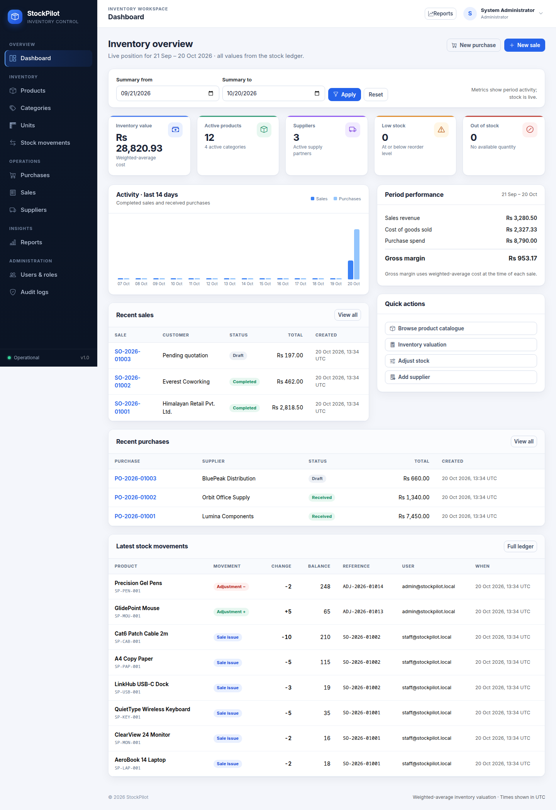
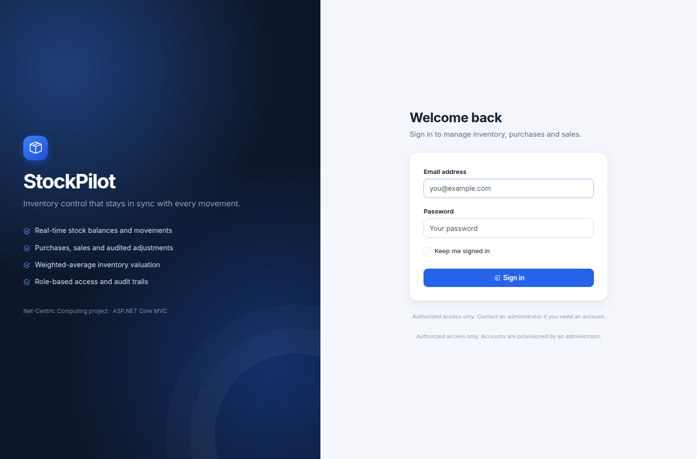
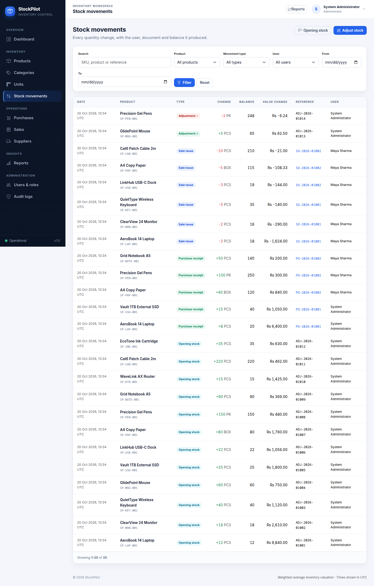
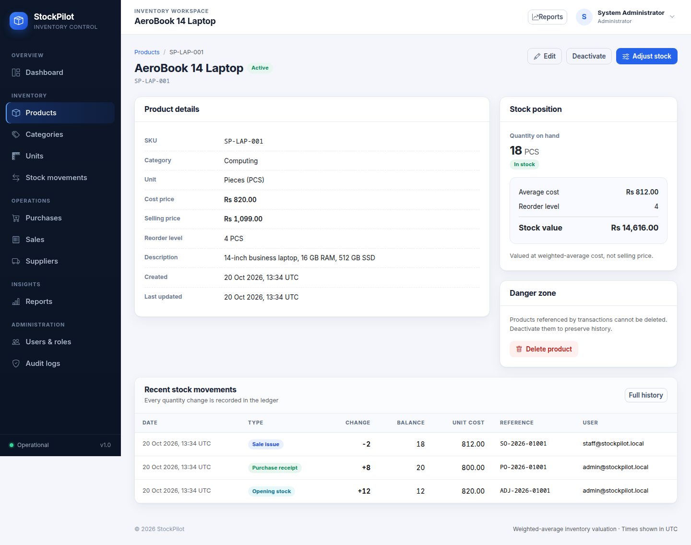
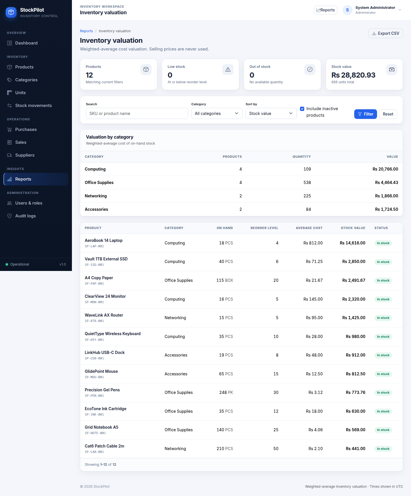
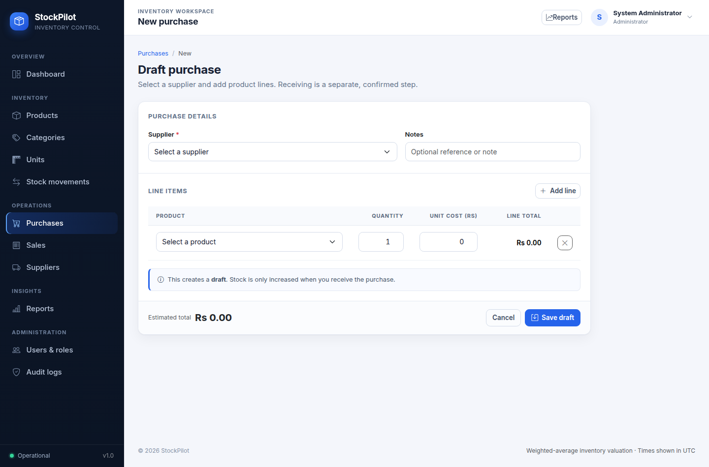
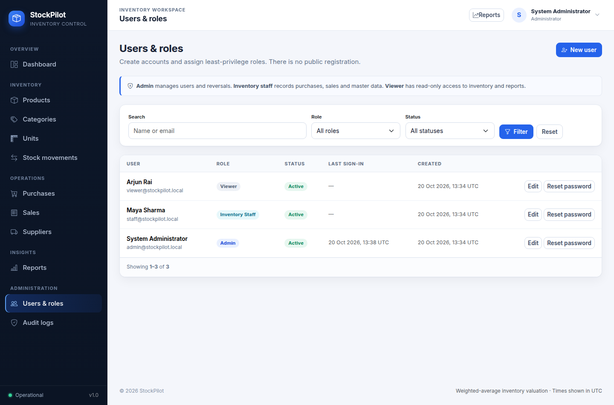
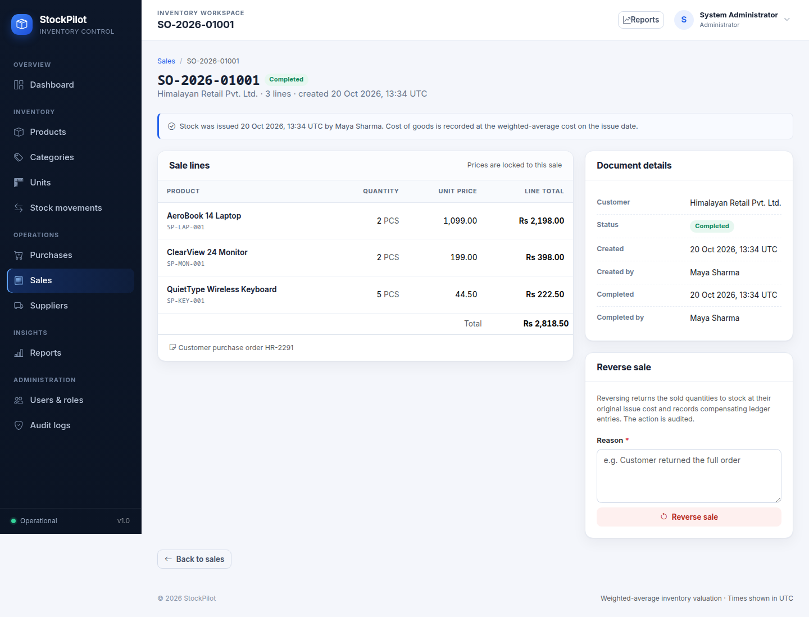
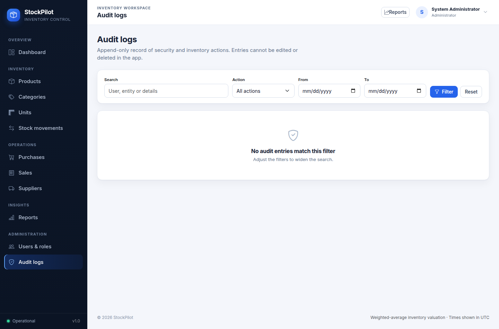

# StockPilot

StockPilot is an inventory and stock-control system built with ASP.NET Core MVC and PostgreSQL.
It records what was bought, what was sold and what is left, and it keeps every quantity change in an
immutable stock ledger so that balances can always be explained.

The project is aimed at small and medium businesses that need a defensible stock position:
server-side validation, weighted-average valuation, concurrency-safe stock deductions, reversible
transactions, role-based access and a complete audit trail.



## Table of contents

- [Features](#features)
- [Technology stack](#technology-stack)
- [Quick start](#quick-start)
- [Configuration](#configuration)
- [Roles and permissions](#roles-and-permissions)
- [How inventory stays correct](#how-inventory-stays-correct)
- [Reports](#reports)
- [Testing](#testing)
- [Container deployment](#container-deployment)
- [Project structure](#project-structure)
- [Documentation](#documentation)
- [Security notes](#security-notes)

## Features

- **Dashboard** – inventory value, product and supplier counts, low/out-of-stock indicators, period
  performance, a 14-day activity chart and recent documents.
- **Master data** – products (SKU, category, unit, cost price, selling price, reorder level),
  categories, units of measurement and suppliers.
- **Purchasing** – draft purchases, editing, receiving (which increases stock), cancelling drafts and
  audited reversal of a received purchase.
- **Sales** – draft sales, editing, completion (which deducts stock after re-checking availability),
  cancelling drafts and audited reversal of a completed sale.
- **Stock control** – opening stock, manual increases/decreases with a mandatory reason, and a
  searchable, filterable movement ledger that shows quantity, balance, cost, value and user.
- **Reports** – current stock, low stock, out of stock, inventory valuation (with a per-category
  breakdown), purchase report, sales report and stock ledger report. Every report exports to CSV.
- **User administration** – admin-managed accounts with three roles, activation/deactivation,
  password reset, self-lockout and last-administrator protection.
- **Audit log** – append-only record of sign-in events, user administration and every stock-affecting
  action, with filtering and detail pages.
- **Enterprise UI** – responsive sidebar/header shell, accessible forms and tables, confirmation
  dialogs for irreversible actions, loading states, empty states and pagination.

### Screenshots

| | |
|---|---|
|  |  |
|  |  |
|  |  |
|  |  |

## Technology stack

| Layer | Choice |
|---|---|
| Runtime | .NET 10 (LTS), C# |
| Web framework | ASP.NET Core MVC with Razor views |
| Database | PostgreSQL 17 |
| Data access | Entity Framework Core 10 with Npgsql |
| Identity | ASP.NET Core Identity (cookie authentication, custom claims) |
| Front end | Bootstrap 5, Bootstrap Icons (vendored locally), custom CSS design system, vanilla JavaScript |
| Tests | xUnit with real PostgreSQL integration tests |

## Quick start

### Prerequisites

- .NET 10 SDK
- PostgreSQL 17 (a local container is fine; Podman or Docker)
- Git

### 1. Start PostgreSQL

```bash
podman run -d --name stockpilot-pg \
  -e POSTGRES_USER=stockpilot \
  -e POSTGRES_PASSWORD=stockpilot_dev \
  -e POSTGRES_DB=stockpilot \
  -p 55432:5432 \
  postgres:17-alpine
```

### 2. Configure secrets

```bash
cp .env.example .env
# Edit .env: set ConnectionStrings__DefaultConnection and a strong Seed__AdminPassword.
```

`.env` is git-ignored. Never commit real credentials.

### 3. Apply migrations and run

```bash
set -a && . ./.env && set +a
dotnet tool restore
dotnet ef database update --project src/StockPilot.Web --startup-project src/StockPilot.Web
dotnet run --project src/StockPilot.Web --urls http://127.0.0.1:5080
```

Open <http://127.0.0.1:5080> and sign in with `Seed__AdminEmail` / `Seed__AdminPassword`.

In Development the app can also seed demonstration data (`Seed__DemoData=true`) that is created
through the real domain services, so the ledger and balances stay consistent.

## Configuration

Configuration comes from environment variables (double underscores map to `:`), for example
`ConnectionStrings__DefaultConnection`. See `.env.example` for the full list.

| Key | Purpose | Default |
|---|---|---|
| `ConnectionStrings__DefaultConnection` | PostgreSQL connection string | required |
| `Seed__AdminEmail` / `Seed__AdminPassword` | Initial administrator created on first startup | required to bootstrap |
| `Seed__AdminFullName` | Display name of the administrator | `System Administrator` |
| `Seed__DemoData` | Seed development demonstration data | `false` |
| `Seed__DemoPassword` | Password for the optional demo staff/viewer accounts | unset |
| `Database__AutoMigrate` | Apply EF Core migrations at startup | `true` in Development |
| `HttpsRedirection__Enabled` | Redirect HTTP to HTTPS | `true` outside Development |
| `ForwardedHeaders__Enabled` | Honour `X-Forwarded-*` behind a reverse proxy | `false` |

Secrets stay out of source control: `appsettings.json` ships with empty values and the application
reads the real values from the environment.

## Roles and permissions

There is **no public registration**. An administrator creates accounts and assigns one role.

| Capability | Admin | Inventory staff | Viewer |
|---|:--:|:--:|:--:|
| View dashboard, products, stock and reports | ✅ | ✅ | ✅ |
| Manage categories, units, products and suppliers | ✅ | ✅ | — |
| Create/edit purchases and sales, receive and complete | ✅ | ✅ | — |
| Opening stock and stock adjustments | ✅ | — | — |
| Reverse received purchases / completed sales | ✅ | — | — |
| Manage users, roles and passwords | ✅ | — | — |
| View audit logs | ✅ | — | — |

Authorization is enforced with policies (`ManageMasterData`, `ManageTransactions`, `ManageInventory`,
`AdminOnly`) plus per-action role checks. Unauthorised signed-in users are redirected to an
access-denied page; anonymous users are sent to sign-in.

## How inventory stays correct

- **Stock ledger** – `StockMovements` is the source of truth. Each row records the signed quantity
  change, the balance after the change, the unit cost used, the reference document and the user.
- **Balances** – `InventoryBalances` holds quantity on hand and weighted-average cost per product.
  Balances and ledger rows are always written inside the same transaction.
- **Weighted-average cost** – purchases blend cost into the average; sales snapshot the average cost
  at issue time on the ledger row; reversals use the recorded cost so valuation is restored.
- **Concurrency control** – documents and inventory rows are locked with `SELECT … FOR UPDATE`.
  Concurrent completions of the same product are serialized, and a conditional quantity check rejects
  any deduction that would take stock below zero.
- **Duplicate-submit prevention** – status transitions are guarded inside the locked transaction
  (`Draft → Received`, `Draft → Completed`), unsafe posts require an antiforgery token, and submit
  buttons lock while a request is in flight. A unique filtered index on the ledger
  (`IX_StockMovements_One_Per_Transaction`) is the final database guard against double posting.
- **Reversals** – reversed documents keep their history: a compensating ledger row is written, the
  original document is flagged `Reversed`, and a reason is required and audited.
- **Validation** – data annotations on view models plus business-rule validation in the service layer
  (positive quantities, non-negative prices, active products, no duplicate product lines, required
  reversal reasons).

## Reports

| Report | Shows | Export |
|---|---|---|
| Current stock | Quantity, reorder level, average cost and value per product | `ExportStock` |
| Low stock | Active products at or below their reorder level | `ExportLowStock` |
| Out of stock | Products with no available quantity | `ExportOutOfStock` |
| Inventory valuation | Value per product plus a per-category breakdown | `ExportValuation` |
| Purchases | Documents, statuses, supplier spend and totals | `ExportPurchases` |
| Sales | Documents, statuses, completed revenue | `ExportSales` |
| Stock ledger | Full movement history with cost and value impact | `ExportMovements` |

CSV exports stream from the same queries as the on-screen report and are capped at 10,000 rows.

## Testing

The test suite runs against a real PostgreSQL database in the same schema as production, not an
in-memory provider, so row locks, constraints and transactions are exercised for real.

```bash
set -a && . ./.env && set +a
dotnet test tests/StockPilot.Tests/StockPilot.Tests.csproj
```

Coverage includes:

- receiving a purchase once, and rejecting a duplicate receive;
- reversing a purchase with compensating ledger entries;
- completing a sale at weighted-average cost and restoring stock on reversal;
- rejecting sales that would overdraw stock;
- concurrent sale completions for the same product (exactly one succeeds);
- rejecting adjustments that would make a balance negative;
- anonymous, staff, viewer and administrator authorization rules;
- antiforgery rejection of unsafe requests without a token.

See [docs/testing.md](docs/testing.md) for details.

## Container deployment

`Dockerfile` and `docker-compose.yml` provide a small production-style stack (app + PostgreSQL).

```bash
cp .env.example .env       # set POSTGRES_PASSWORD, Seed__AdminEmail, Seed__AdminPassword
docker compose up --build
```

The app listens on port `8080`, exposes `/health`, and applies migrations on startup when
`Database__AutoMigrate=true`. See [docs/deployment.md](docs/deployment.md) for free-tier guidance,
proxy/TLS notes and a migration-job pattern.

## Project structure

```
StockPilot/
├── Dockerfile
├── docker-compose.yml
├── docs/                     architecture, database, use cases, testing, deployment, demo script
├── src/StockPilot.Web/
│   ├── Constants/            roles and authorization policies
│   ├── Controllers/          MVC controllers
│   ├── Data/                 DbContext, configurations, seeding
│   ├── Entities/             domain model
│   ├── Infrastructure/       helpers (decimal math, ledger locking, CSV, pagination, UI helpers)
│   ├── Migrations/           EF Core migrations
│   ├── Services/             business services (purchases, sales, stock, reports, users, audit)
│   ├── ViewModels/           form, report and dashboard models
│   ├── Views/                Razor views
│   └── wwwroot/              CSS design system, JavaScript, vendored libraries
└── tests/StockPilot.Tests/   PostgreSQL integration and authorization tests
```

## Documentation

- [Architecture](docs/architecture.md) – layering, request flow, concurrency strategy.
- [Database](docs/database.md) – entities, relationships, constraints, ER diagram, migrations.
- [Use cases](docs/use-cases.md) – actors and end-to-end workflows.
- [Testing](docs/testing.md) – how to run and extend the test suite.
- [Deployment](docs/deployment.md) – containers, configuration, free-tier notes.
- [Demo script](docs/demo-script.md) – a guided walkthrough for presentations.

## Security notes

- No public registration; accounts are created by an administrator.
- ASP.NET Core Identity with hashed passwords, lockout after repeated failures and a strong password
  policy (length, upper/lower, digit, non-alphanumeric, unique characters).
- Antiforgery validation on every unsafe request; SameSite cookies; HttpOnly auth cookie.
- Security headers (`X-Content-Type-Options`, `X-Frame-Options`, `Referrer-Policy`,
  `Permissions-Policy`, Content-Security-Policy) applied to every response.
- Audit logging of sign-in, sign-out, failures, user administration and stock actions.
- Secrets are supplied through environment variables and are never committed.

## Limitations and future work

- Single warehouse / single location; the model can be extended with a location dimension.
- Valuation uses weighted-average cost only (no FIFO/LIFO).
- No purchasing/sales API; the UI is server-rendered MVC.
- CSV export is synchronous and capped; large datasets would need background export jobs.
- Screenshots and demo data are for development and illustrative purposes only.
